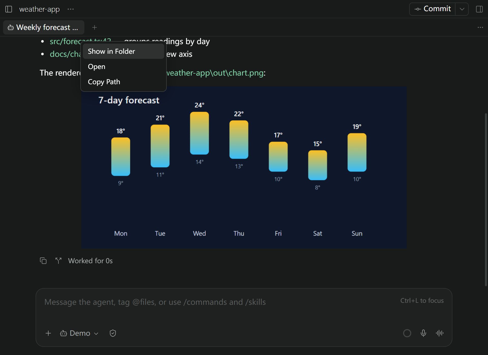
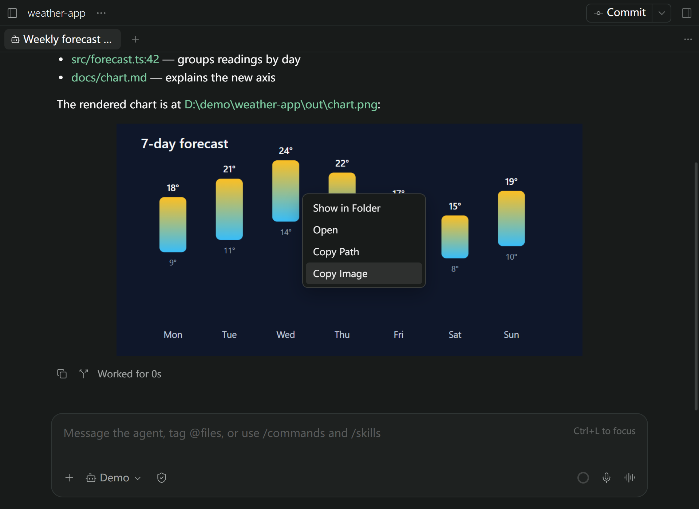

# File Links for Paseo

Right-click a local file link or image in a [Paseo](https://paseo.sh) agent reply to
show it in its folder, open it, or copy its path.

Agents often reply with paths such as `src/app.ts:42` or `D:\out\chart.png`.
File Links turns those links into a small menu, so you can go straight to the file.



## Install

Requires **Paseo 0.13.2 or later**.

```bash
paseo plugin install https://github.com/stv1024/paseo-file-links
```

If the menu does not show, reload the Paseo window (**Ctrl+R**, or **Cmd+R** on macOS).

## Use

Right-click a local file link in an agent reply:

| Item | What it does |
| --- | --- |
| **Show in Folder** | Opens File Explorer or Finder with the file selected. A folder link opens the folder. |
| **Open** | Opens the file with its default app. |
| **Copy Path** | Copies the absolute path. |

Right-click an image in an agent reply to get **Copy Image** too. The file items
show only when the image comes from a local file.



Left-click keeps Paseo's own behavior. To get the browser menu instead, hold
**Shift** (or any other modifier key) while you right-click.

### Supported links

- Windows paths: `D:\work\report.md`, `\\server\share\a.txt`
- `file://` URLs
- Absolute POSIX paths: `/home/me/a.md`
- Home paths: `~/notes.md`
- Paths relative to the workspace: `src/app.ts`

Line suffixes such as `:42`, `:42:7`, `(42,7)` and `#L42` are ignored, so the menu
acts on the file. Web links (`https://…`, `mailto:`) keep the normal menu.

### A few things to know

- The daemon runs the file manager. The folder opens on the computer that runs the
  Paseo daemon, not on a remote client.
- If the file does not exist, the menu shows **File not found** and keeps
  **Copy Path** available.
- Images that an agent reads are often temporary copies, so **Show in Folder** can
  open a temp folder.
- The menu works in the desktop and web apps. The mobile app has no right-click.
- The menu follows Paseo's app language. Simplified Chinese is translated; other
  languages show English.


## Update

```bash
paseo plugin update file-links --check
paseo plugin update file-links
```

## Development

```bash
npm install
npm run typecheck
npm test
```

Install your working copy into Paseo with `paseo plugin install <path-to-this-folder>`,
then run `paseo plugin reload file-links` after each change.

| Path | Contents |
| --- | --- |
| `client/web.ts` | The right-click menu (web only). |
| `server/file-links.ts` | Path resolution and the file manager commands. |
| `shared/file-links.ts` | The RPC and the link parser, used by both sides. |

For errors or unexpected behavior, [open an issue](https://github.com/stv1024/paseo-file-links/issues).
Include your Paseo version, your OS, and the link text. Logs are available with
`paseo plugin logs file-links`; remove private paths before you share them.

## License

[MIT](LICENSE)
